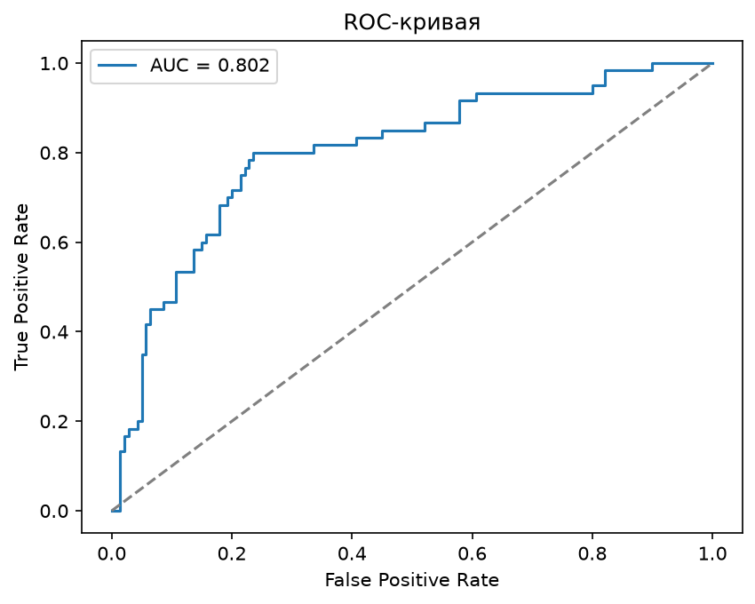
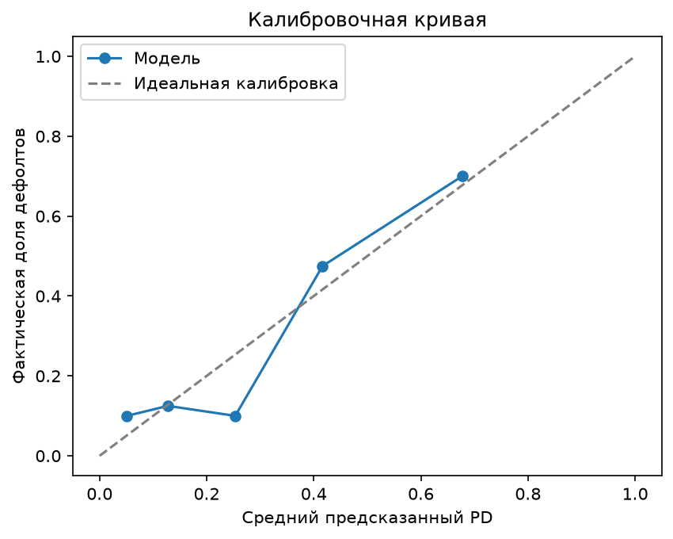
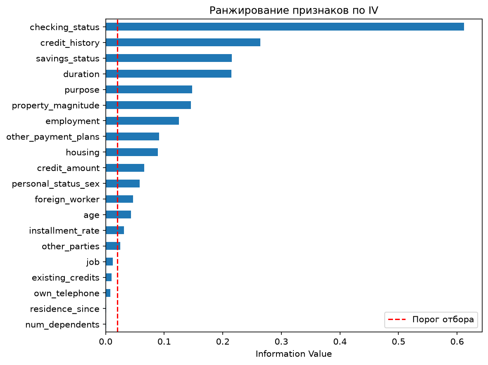

# Итоговый отчёт: скоринговая карта розничного кредитования

**Датасет:** German Credit (UCI, id=144) · **Модель:** WOE-биннинг + логистическая регрессия ·
**Выборка:** 1000 заявок (800 train / 200 test, стратифицированное разбиение, seed=42)

## Постановка

Банк оценивает вероятность дефолта (PD) заёмщика по данным анкеты — доход, кредитная
история, цель кредита, стаж работы и т.д. — ещё до выдачи кредита. Это задача
application-level скоринга, в отличие от портфельных моделей (Vasicek/ASRF), которые
оценивают риск на уровне всего портфеля, а не отдельной заявки. Цель — построить
скоркарту, которая по признакам заявки выдаёт PD и балл, и оценить её разделительную
способность и калибровку.

## Что сделано

1. **EDA и очистка.** Загружены 20 признаков + целевая переменная (0 = good, 1 = bad,
   доля дефолтов 30%). Пропусков не обнаружено. Четыре численных признака низкой
   кардинальности (`installment_rate`, `residence_since`, `existing_credits`,
   `num_dependents`) обработаны как категориальные.
2. **WOE-биннинг и отбор по IV.** Редкие категории объединены; непрерывные признаки
   разбиты на квантильные бины с расширенными внешними границами (корректная обработка
   значений вне диапазона train, например `duration=72`). Признаки с IV < 0.02
   (`job`, `own_telephone`, `existing_credits`, `residence_since`, `num_dependents`)
   отброшены как непредсказательные — осталось 15 из 20.
3. **Логистическая регрессия** обучена на 15 WOE-преобразованных признаках.
4. **Перевод в баллы скоркарты** (Offset=600, PDO=20): построена полная таблица
   признак → бин → баллы (63 строки), с воспроизводимым расчётом на примере заявителя.
5. **Сервис.** Артефакты сохранены; реализованы FastAPI-эндпоинт
   `POST /credit-scorecard/score` и Streamlit-интерфейс для ручного ввода заявки.

Весь код воспроизводим «сверху вниз» с фиксированным seed=42; среда зафиксирована в
`environment.yml` и проверена в чистом окружении.

## Ключевые результаты

| Метрика | Значение | Критерий приёмки |
|---|---|---|
| Gini (test) | **0.604** | ≳ 0.4 ✅ |
| KS-статистика | **0.571** | — |
| Средний предсказанный PD | 0.305 | факт 0.300 ✅ (калибровка) |
| AUC | 0.802 | — |

Модель уверенно превышает бенчмарк по Gini. Калибровка на уровне агрегата хорошая
(разница 0.5 п.п.); на уровне отдельных бинов калибровочная кривая шумная — это
ожидаемо при тестовой выборке в 200 наблюдений и не указывает на проблему модели.

**Ранжирование признаков по IV:**

| Признак | IV |
|---|---|
| `checking_status` | 0.612 |
| `credit_history` | 0.264 |
| `savings_status` | 0.215 |
| `duration` | 0.215 |
| `purpose` | 0.148 |
| `property_magnitude` | 0.146 |

Переход от 5 вручную отобранных признаков (Gini 0.595) к полному набору из 15 (Gini 0.604)
дал умеренный прирост — около 0.01. Основную разделительную способность обеспечивает
небольшое число сильных предикторов, в первую очередь `checking_status`.

**Пример расчёта балла** для трёх заявителей из тестовой выборки:

| Профиль | Баллы | PD |
|---|---|---|
| Низкий риск | 734.70 | 0.93% |
| Средний риск | 621.77 | 31.98% |
| Высокий риск | 547.63 | 86.00% |

Баллы монотонно убывают с ростом PD; разброс в 187 баллов между крайними случаями
подтверждает содержательную разделительную способность скоркарты на всём диапазоне риска.

## Экономическая интерпретация

- **`checking_status`** — самый сильный предиктор (IV 0.61), что ожидаемо: текущий
  остаток на расчётном счёте — прямой индикатор ликвидности заёмщика на момент подачи
  заявки.
- **`credit_history`** демонстрирует контринтуитивный паттерн: бин «кредитов не было /
  все погашены» имеет самую высокую долю дефолтов — выше, чем у заёмщиков с историей
  просрочек. Отсутствие кредитной истории означает отсутствие данных о поведении
  заёмщика, что банк трактует как более высокий, а не более низкий риск.
- **`installment_rate`** имеет низкий самостоятельный IV (0.03), но получает наибольший
  по модулю коэффициент в регрессии (−1.33) — признак несёт информацию, слабо
  пересекающуюся с остальными, и поэтому вносит больший вклад в многомерной модели,
  несмотря на скромную одномерную предсказательную силу.
- Все коэффициенты регрессии имеют согласованный знак, что подтверждает корректность
  направления влияния каждого признака.

## Ограничения

- Размер тестовой выборки (n=200) ограничивает точность оценки метрик на уровне
  отдельных бинов; агрегированные метрики (Gini, KS, общая калибровка) более надёжны.
- Датасет 1990-х годов (суммы в немецких марках) — отсутствуют макроэкономические
  факторы и эффекты временных когорт (vintage effects).
- `checking_status` имеет высокий IV (0.61), что по общим критериям (>0.5) требует
  проверки на утечку целевой переменной. Сигнал признан подлинным — остаток на счёте
  физически не может быть известен постфактум дефолта, — но при переносе методологии на
  другой датасет эту проверку стоит повторять.
- Модель не включает признаки взаимодействия между переменными — возможное направление
  развития.
